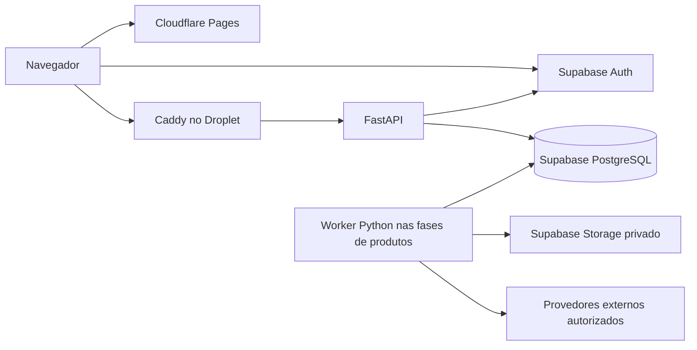

# Arquitetura da FuturaNext

O [diagnóstico](DIAGNOSTICO_ATUAL.md) registra a landing recebida. A Fase 1 implementa o núcleo de conta, empresas, catálogo, licenças e portal. O FastAPI atende o frontend local e verifica as sessões do Supabase Auth. O piloto hospedado foi definido com Supabase Free. O [plano e as decisões](DECISOES.md) detalham a divisão do trabalho.

## Componentes e acesso

- O frontend continua em HTML/CSS/JS. A publicação usa `dist/` gerado por uma lista explícita de arquivos públicos. `/` conserva a estrutura e as funcionalidades atuais. A área autenticada usa folhas de estilo e módulos JS próprios, aproveitando a identidade existente. O serviço local atende a landing page, as rotas novas e a API, com URLs relativas sempre que possível.
- Na nuvem, Pages entrega a interface e Caddy encaminha a API ao FastAPI. CORS aceita somente as origens exatas do ambiente. O portal pode ser entregue como arquivos estáticos porque toda leitura e mutação privadas passa pela API. Arquivos restritos e configurações de servidor ficam fora de `dist/`. [Roteamento e páginas de erro no Cloudflare Pages](https://developers.cloudflare.com/pages/configuration/serving-pages/)
- FastAPI é um monólito modular com rotas e schemas, casos de uso, políticas, repositórios SQLAlchemy e adaptadores HTTP. Usar Python 3.12 como base do contêiner e confirmar a resolução de dependências e a suíte antes de declarar suporte a outras versões. Alembic mantém uma única linha de migrações. PostgreSQL é provido pelo Supabase em HML/PROD. O ambiente de desenvolvimento usa um projeto Supabase local ou dedicado.
- Na Fase 1, `GET /health/live` verifica o processo e `GET /health/ready` verifica conectividade e compatibilidade do schema do banco, com timeouts curtos e resposta sem detalhes de conexão. A disponibilidade do Auth recebe monitoramento próprio. A especificação OpenAPI parte dos contratos reais em `/api/v1`; em produção, restringir a interface interativa de documentação conforme o ambiente.

## Contratos do portal

| Interface | Fluxo |
| --- | --- |
| `/login`, `/recuperar-senha`, `/ativar-conta` | Login com e-mail e senha, recuperação e ativação via Supabase Auth. Administradores elevam a sessão para `aal2` via TOTP antes de ações administrativas. |
| `/portal`, `/portal/produtos`, `/portal/perfil`, `/portal/usuarios` | Selecionar empresa, usar ferramentas liberadas, solicitar novas ferramentas e gerenciar perfil. Cliente admin com MFA gerencia usuários comuns na empresa selecionada. |
| `/admin/clientes`, `/admin/usuarios`, `/admin/produtos`, `/admin/assinaturas`, `/admin/acessos`, `/admin/solicitacoes` | Gestão de empresas, convites, acessos por empresa, catálogo, licenças e solicitações com auditoria das alterações. |
| `/api/v1/auth/context`, `/api/v1/auth/invitations/{invitation_id}/accept`, `/api/v1/tenants/{tenant_id}/products` | Contexto de identidade e empresas elegíveis, aceite explícito de convite e leitura do catálogo autorizado no tenant informado. |
| `/api/v1/admin/*` | Operações administrativas separadas por recurso, com checagens de papel, escopo, ação e MFA. |
| `/api/v1/tenants/{tenant_id}/tools/*` | Agenda e configurações de conversa, parâmetros fiscais e certificados, portais externos e estado dos webhooks de WhatsApp. |

O catálogo usa identificadores estáveis e licenças por empresa. As ferramentas externas podem ser cadastradas por link. Ferramentas com dados próprios reutilizam a verificação de acesso e têm políticas por empresa nas próprias tabelas. A interface carrega o código de cada módulo apenas quando aberto. [Guia de operação e atualização do portal](PORTAL_FERRAMENTAS.md)

## Identidade, autorização e banco

1. Supabase Auth mantém senhas e fatores. A área autenticada usa token Bearer, com sessão por aba e SDK empacotado localmente. O backend valida assinatura e claims obrigatórias a partir do emissor configurado para o ambiente. A identidade é o UUID `sub`. O fluxo de convites consulta a identidade confirmada no Auth. [JWT no Supabase](https://supabase.com/docs/guides/auth/jwts)
2. Cada operação sobre uma empresa recebe seu UUID explicitamente na rota. A API verifica associação atual, organização ativa, ação permitida e, para recursos de produto, licença vigente. Um papel de suporte exige atribuição ativa à empresa. Papéis globais vêm do banco do aplicativo. Uma troca de empresa exige nova consulta e invalida os dados da empresa anterior na tela. A seleção do navegador só determina qual contexto pedir.
3. As tabelas do aplicativo ficam em schema privado, com privilégios explícitos e Data API desabilitada quando dedicada ao projeto. A conta de migração possui o schema. A API usa uma conta de runtime sem `BYPASSRLS` e sem propriedade das tabelas. Cada transação configura `user_id`, `tenant_id` e nível de MFA verificados, com `set_config(..., true)` parametrizado. Políticas falham fechadas com contexto ausente, restringem `SELECT`/`DELETE` por `USING` e `INSERT`/`UPDATE` também por `WITH CHECK`. O catálogo global tem política própria. Operações de administração global usam permissões próprias e ficam auditadas. [RLS no PostgreSQL](https://www.postgresql.org/docs/current/ddl-rowsecurity.html) · [Proteção da Data API](https://supabase.com/docs/guides/api/securing-your-api)
4. As permissões ficam no banco em `roles`, `permissions`, `role_permissions` e concessões de usuário quando necessárias. `organizations`, `profiles`, `organization_memberships`, `products`, `tenant_products`, convites, atribuições de suporte e `audit_logs` formam o núcleo. Use UUIDs, unicidade por associação/licença, timestamps UTC, chaves estrangeiras e índices nos vínculos. Em modelos com pai e filho da mesma empresa, use FKs compostas com o identificador do tenant. As tabelas de domínio e os dados que exigem retenção própria entram junto de seus casos de uso.

| Papel | Escopo |
| --- | --- |
| `super_admin` | Gestão global explícita com sessão `aal2`. Bootstrap operacional idempotente para uma conta verificada. |
| `suporte` | Ações de suporte dentro de atribuições ativas e com `aal2` no painel. |
| `cliente_admin` | Gestão de usuários da própria empresa com permissões explícitas, limitada aos papéis que pode delegar. |
| `cliente_usuario` | Ações permitidas dentro da empresa escolhida e dos produtos contratados. |

## Módulos e próximas integrações

- **Barbearia e clínica.** Compartilham o módulo de agenda e os cadastros de profissionais, serviços e produtos. Cada empresa configura seu expediente e as regras de conversa. A agenda valida disponibilidade no banco e protege os horários contra reservas simultâneas por profissional. Os horários são armazenados em UTC e exibidos em `America/Sao_Paulo`. Os futuros bots podem consumir os contratos do módulo.
- **NFS-e.** Emissão e consulta têm licenças e configurações independentes, com certificados A1 cifrados. A transmissão de lotes e a distribuição de notas serão integradas após homologação. A emissão deve deduplicar por chave de negócio e reconciliar retornos incertos antes de reenviar. [Guia fiscal](NFSE.md)
- **WhatsApp e Equinos.** O portal autoriza o acesso à empresa e entrega os links configurados pelo operador. A API WhatsApp encaminha eventos assinados a destinos cadastrados no worker. A Equinos mantém seu próprio login e a automação de cotações. [Integrações externas](INTEGRACOES_EXTERNAS.md)
- **Fila durável.** Quando houver trabalho realmente assíncrono, começar com `background_jobs` em PostgreSQL. Uma transação registra eventos de negócio e jobs de forma atômica. O worker reserva jobs em transações curtas, com lease recuperável e tentativas limitadas. Executar I/O fora do lock e persistir resultado auditável. Controlar concorrência por tenant/provedor. Migrar para fila gerenciada ou Redis/Valkey apenas com justificativa operacional.
- **Anexos e documentos.** Buckets privados, metadados por tenant e URLs temporárias emitidas após revalidar autorização. Backups de objetos e banco têm escopo e procedimentos de recuperação próprios. O ciclo de vida do objeto acompanha as regras de retenção do módulo.
- **Suporte, leads e IA.** Dados separados por empresa, com prioridade, histórico e retenção definidas. Leads exigem escolha afirmativa explícita antes da persistência. Uso opcional de IA passa por fontes e escopos autorizados, orçamento por tenant e validação transacional para operações de agenda. Emissão e gestão de credenciais ficam fora da interface de IA.

## Ambientes

O desenvolvimento usa credenciais sintéticas. HML e PROD usam projetos distintos de Supabase, buckets separados, DNS e SMTP próprios, além de segredos e instâncias de aplicação isolados. O frontend de HML só consulta serviços de HML. O dimensionamento inicial usa medições de CPU, RAM, latência, conexões e fila. O [guia de implantação](DEPLOY_DIGITALOCEAN.md) cobre promoção e recuperação, e o [levantamento de custos](CUSTOS.md) inclui o preço do isolamento.
