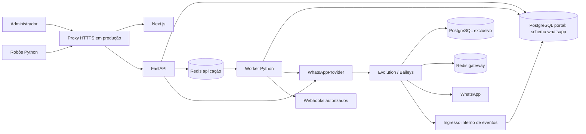

# Arquitetura da plataforma própria de WhatsApp

Atualização de cobrança (14/11/2026): Extensão financeira: adapter Asaas separado, assinatura mensal no provedor; webhook sinaliza consulta canônica e rotina financeira separada do despacho WhatsApp. Zoho reutilizado para lembretes. Worker com saída para APIs externas, sem novas portas. Ver docs/BILLING.md.

Análise: 12/11/2026. Desenho da Fase 1; não equivale a recursos implementados. Fontes em docs/SOURCES.md e verificação em docs/VALIDATION.md.

Atualização de persistência (18/11/2026): MongoDB substituído pelo PostgreSQL do portal (schema privado `whatsapp`, migração Alembic `0013_whatsapp_service`, papéis `wa_api`/`wa_worker`, RLS forçada). Login, contas, cobrança e consentimento por destinatário próprios foram removidos: o portal é a fonte única. As decisões 2 e 4 abaixo foram revisadas. Ver docs/WHATSAPP_POSTGRES.md na raiz do repositório.

## Decisões técnicas

1. Monólito modular FastAPI, frontend Next.js e worker usando o mesmo domínio Python. Sem Kubernetes, UltraMsg ou Z-API.
2. PostgreSQL do portal (Supabase) guarda os dados da plataforma no schema privado `whatsapp`. Acesso assíncrono com psycopg 3 + psycopg-pool e SQL parametrizado; schema versionado pelo Alembic do portal. Licença, empresa e aceite são lidos do schema `futuranext` por funções SECURITY DEFINER.
3. Evolution 2.3.7 exige PostgreSQL/MySQL. PostgreSQL 15 exclusivo do gateway segue o major do Compose oficial. Backend não consulta esse banco; Prisma e suas migrações pertencem à Evolution.
4. Separar Redis da aplicação do cache Redis do gateway. PostgreSQL é a fonte durável dos trabalhos (claim com `FOR UPDATE SKIP LOCKED` e lease); Redis Streams transporta IDs e sinais, nunca a única cópia do envio.
5. Release estável consultada: tag Git `2.3.7`, imagem `evoapicloud/evolution-api:v2.3.7`. Sem latest ou pré-release. A existência da imagem não comprova compatibilidade atual com WhatsApp.
6. Fase 2 oferece identificação e probes; sem dashboard, QR ou contadores fictícios. Funcionalidades pertencem à Fase 3.

## Fronteiras e estrutura

Frontend chama somente a API própria; chave administrativa Evolution fica em backend/worker. Gateway sem portas publicadas, com saída à internet. Bancos em redes internas. Local publica API/frontend em loopback. Em produção Caddy expõe 443 e redireciona 80, sem encaminhar `/internal/*` ou manager Evolution.

`backend/app`: configuração, health, depois auth, tenants, instances, messages, consents, api_keys, audit, webhooks, repositories e providers. Rotas validam/autorizam; serviços aplicam regras; repositórios impõem empresa; adapters traduzem gateway. `frontend`: App Router, TypeScript, Tailwind na Fase 3. `workers`: entradas de consumidores do mesmo domínio. `integrations/python`: SDK HTTP. `infrastructure`, `scripts`, `tests`, `examples`, `docs`: implantação, operações, validação, robôs e decisões.

Interface prevista `WhatsAppProvider`: create_instance, connect, get_connection, disconnect, delete_instance, send_text, send_image, send_document, normalize_event e capabilities. Retornos normalizados: provider_message_id, estado e instante. Erros: rejeição definitiva, indisponibilidade comprovada antes de enviar e resultado incerto. Cloud API futura declara capacidades; QR não é pressuposto universal. Recurso não suportado retorna 422. SDK não conhece Evolution.

## Processamento confiável

API autentica, autoriza instância, valida consentimento/opt-out e limites. Insere mensagem `queued` e intenção de despacho no mesmo documento atômico. Índice único parcial resolve concorrência de idempotência. Se publicação Redis falhar, dispatcher reencontra a linha pendente. Não presumir transação entre PostgreSQL e Redis.

Worker obtém lease atômico, revalida consentimento/limites e registra tentativa antes do I/O. ACK Redis após persistência. Lease expirado após início do envio vira `unknown`, não reenvio cego. Eventos do gateway são persistidos/deduplicados antes de HTTP 200; falha de persistência retorna 503. Correlacionar tenant, instância e ID do provedor; evento atrasado não regride delivered/read para sent.

Backoff com jitter (5s, 30s, 120s; máximo 3 tentativas) só com evidência de não envio ou falha segura. Timeout de leitura/queda após escrita é ambíguo. Não prometer exactly-once no provedor. Webhooks externos usam jobs independentes, IDs estáveis e assinatura HMAC.

Conexão: creating, disconnected, connecting, connected, expired, error, deleting. Monitor a cada 30s; gateway indisponível não prova logout. QR efêmero privado, validade do provedor limitada localmente a 60s; SSE autenticado com fallback de polling. Reconexão apenas por métodos suportados.

## Operação

Ensaio inicial: VPS 2 vCPU/4 GB, uma instância, baixa vazão; não é garantia de capacidade. Medir RSS Baileys, disco, atraso de fila e latência. Limite conservador inicial: 1 envio/5s/instância, 100/dia/empresa; não representa limite oficial nem evita restrições.

Liveness mede processo, readiness dependências; estado de número separado. Worker real publica heartbeat. Probes públicos mínimos e detalhes futuros restritos a administrador. HTTPS, backups, observabilidade e produção somente após fases correspondentes.

WhatsApp Web não oficial pode sofrer restrição, desconexão e incompatibilidade. Usar números autorizados, consentimento e opt-out. Sem spam ou evasão. Preservar possibilidade de Cloud API, respeitando diferenças de capacidades.
